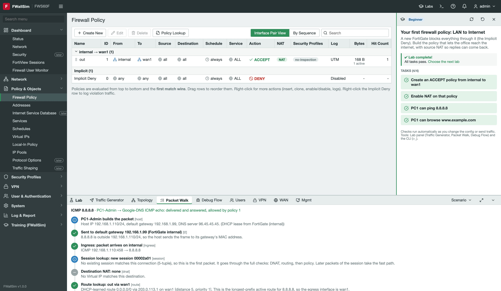
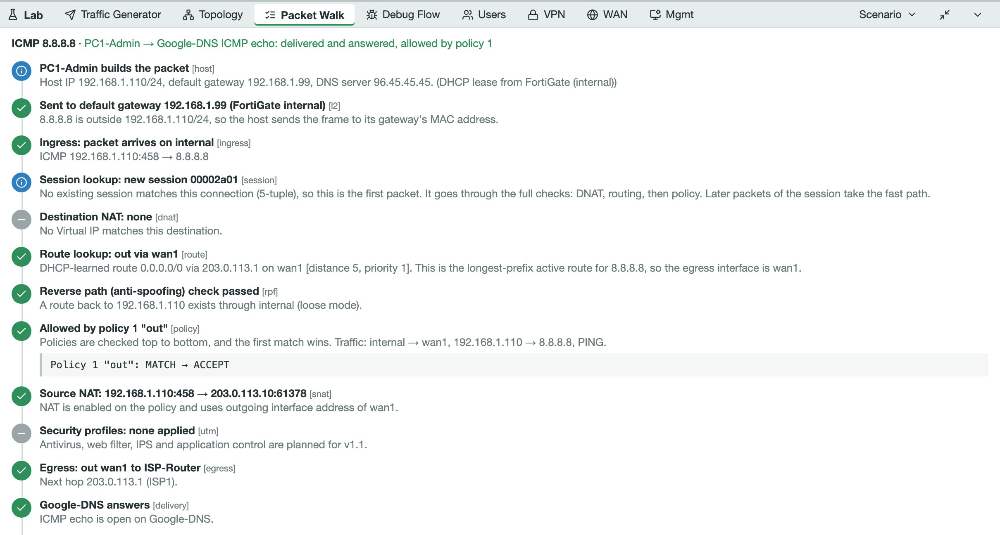
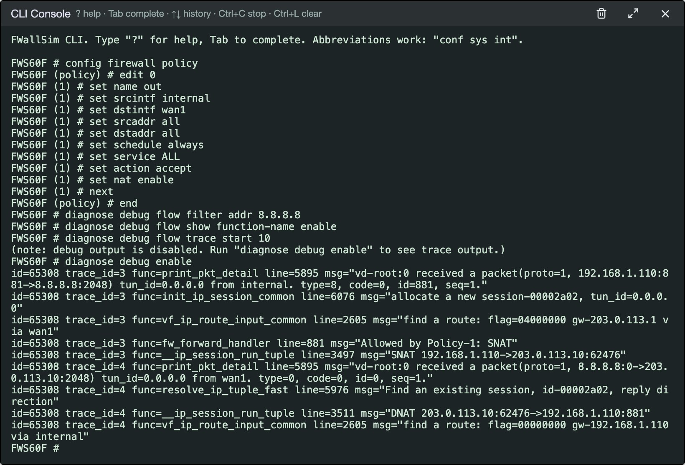
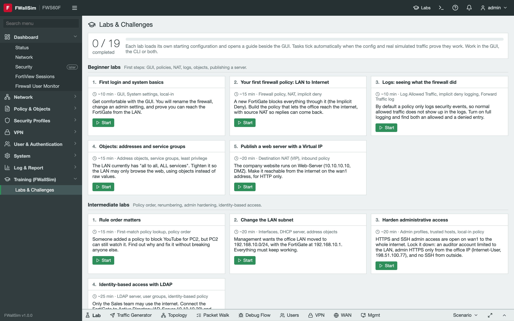
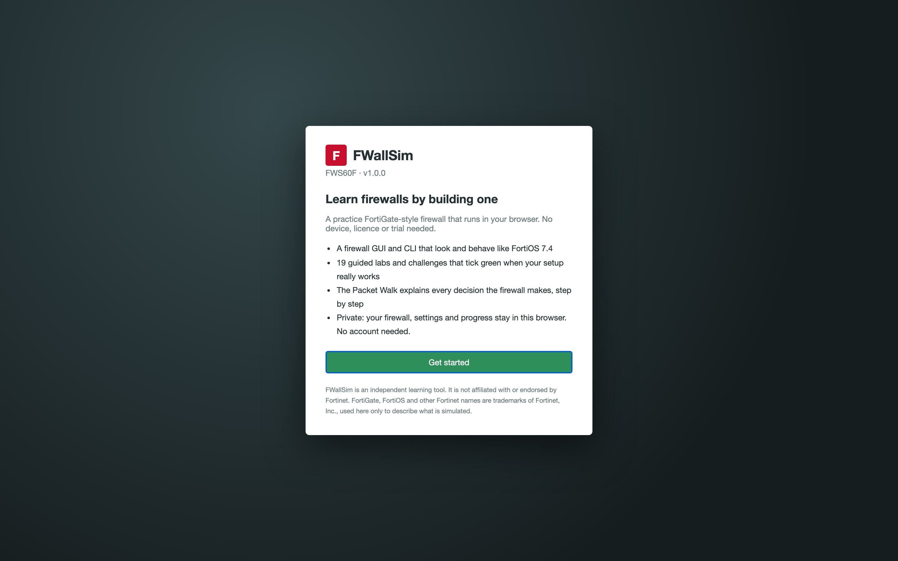

# FWallSim

**Learn firewalls hands-on, in your browser.** FWallSim is a practice FortiGate-style firewall that you configure yourself, with a GUI and CLI modelled on FortiOS 7.4, a built-in lab network to send traffic through, and guided labs that tick green when your setup really works. No hardware, licence, vendor trial or account needed.

[](media/fwallsim-tour.mp4)

<sub>Click the preview to watch the video with sound.</sub>

**▶ Try it now: https://fwallsim.vercel.app**: free, nothing to install, and your simulator stays private in your own browser.

## Who it's for

Anyone who wants to learn firewalls by doing, not just by reading:
- beginners in networking or security who have never touched a firewall
- students and junior network or security engineers who want practice before working on real devices
- anyone preparing for a firewall job who wants to try the screens and commands first

You don't need to know anything in advance. Lab 1 starts with logging in and renaming the firewall.

## What you'll learn

| Level | Topics |
|---|---|
| Beginner (5 labs) | First login and system basics, your first firewall policy and NAT, reading logs, address and service objects, publishing a web server with a Virtual IP |
| Intermediate (4) | Why rule order matters, changing the LAN subnet, hardening admin access, identity-based access with LDAP |
| Advanced (4) | Site-to-site IPsec VPN, SSL-VPN for remote workers, SD-WAN with two ISPs, OSPF over VPN and BGP |
| Challenges (6) | Broken networks to fix, with hints: "Nobody can browse the internet", "Pings work, websites do not", "Our website is down", "PC2 has no network", "The branch office is cut off", "The backup line never takes over" |

## How it works

1. **Pick a lab** (the **Labs** button). It loads a starting setup and opens a Lab Guide with tasks.
2. **Configure the firewall** in the GUI or the CLI, as you would on a real one.
3. **Send traffic** from the lab PCs, servers, the internet or an attacker (the Lab panel at the bottom).
4. **See why it worked or failed.** The **Packet Walk** explains every step the firewall took (routing, policy, NAT) in plain words, and **Debug Flow** shows the same as `diagnose debug flow`.
5. **Tasks tick green** only when the configuration and the simulated traffic prove it works.

Each lab also has a printable class in [course/pdf/](course/pdf) with click-by-click steps and screenshots.

## Screenshots

[](https://fwallsim.vercel.app)

| | |
|---|---|
|  |  |
| **Packet Walk:** routing, policy and NAT, step by step | **CLI:** FortiOS-style commands and a live `diagnose debug flow` |
|  |  |
| **19 labs and challenges**, from first login to BGP | **First visit:** create your admin password and start |

## Run it on your own computer

You need **Node.js 18 or newer** (20+ recommended) and **Git**.

| | Install Node.js and Git |
|---|---|
| macOS | `brew install node git` (with [Homebrew](https://brew.sh)) |
| Windows | Download from [nodejs.org](https://nodejs.org) and [git-scm.com](https://git-scm.com), or `winget install OpenJS.NodeJS.LTS Git.Git` |
| Linux | Your package manager, or [nodejs.org](https://nodejs.org) |

Then, in a terminal:

```bash
git clone https://github.com/Saaamyak/fwallsim.git
cd fwallsim
npm install        # one time, about a minute
npm run dev        # starts FWallSim at http://localhost:5173
```

Your browser opens **http://localhost:5173**. Click **Get started**, create your admin password, and you're in. Press **Ctrl+C** in the terminal to stop.

Prefer not to keep a terminal open? Use the start/stop scripts, which run FWallSim in the background:

| | macOS / Linux | Windows |
|---|---|---|
| Start | `./start-fwallsim.sh` | Right-click `start-fwallsim.ps1` → Run with PowerShell |
| Stop | `./stop-fwallsim.sh` | `stop-fwallsim.ps1` |

To get updates later: `git pull`, then `npm install`.

**If something goes wrong**

| Problem | Fix |
|---|---|
| `command not found: node` or `npm` | Install Node.js (above), then open a new terminal |
| `Port 5173 is in use` | FWallSim is already running: open http://localhost:5173, or stop it first |
| Errors mentioning `esbuild`, `rollup` or "wrong platform" | `node_modules` came from another computer. Delete the `node_modules` folder and run `npm install` again |
| Forgot the FWallSim admin password, or locked out | Login page → **Forgot password or locked out? Reset to factory defaults**. Your training progress is kept |

**Host your own copy:** `npm run build` writes a static site to `dist/`. Any free static host can serve it (Vercel, Netlify, Cloudflare Pages); there's no server to run. See [docs/HOW-TO.md](docs/HOW-TO.md#publish-to-github-and-a-free-host).

## What you can do

### The GUI
- **Dashboard**: Status (system info, front panel, CPU/memory/sessions), Network (routing table, DHCP leases, interface counters), FortiView Sessions, Firewall User Monitor
- **Network**: Interfaces (hardware switch, VLANs, zones, DHCP server, administrative access), DNS, SD-WAN, Static Routes, Policy Routes, OSPF, BGP
- **Policy & Objects**: Firewall Policy (interface-pair and sequence views, drag to reorder, right-click menu, Policy Lookup), Addresses and groups, Services and groups, Schedules, Virtual IPs, Local-In Policy, IP Pools
- **VPN**: IPsec Tunnels and the IPsec Wizard, SSL-VPN Portals and Settings
- **User & Authentication**: local users, groups, LDAP and RADIUS servers, authentication settings
- **System**: Administrators, Admin Profiles, Firmware, Settings (hostname, admin ports, idle timeout, lockout, themes), SNMP; Backup/Restore of a FortiOS-format `.conf`, Reboot, Factory reset
- **Log & Report**: Forward Traffic, Local Traffic, System Events, Log Settings (including remote syslog)

### The CLI (the `>_` button)
Works like FortiOS: `?` for help, Tab to complete, ↑/↓ history, Ctrl+C to stop, unique abbreviations (`conf sys int`, `diag deb flow`).
- **Config mode**: `config` / `edit` (`edit 0` = next free ID) / `set` / `unset` / `append` / `select` / `unselect` / `next` / `end` / `abort`, plus `delete`, `purge`, `move`, `rename`, `clone`. Values are validated as on a real unit (datasources, required attributes, value ranges, overlapping subnets), and changes appear in the GUI immediately.
- **show / get**: `show`, `show full-configuration`, `get system status`, `get system interface`, `get router info routing-table all`, `get router info bgp|ospf ...`, `get vpn ipsec tunnel summary`, `get vpn ssl monitor`; pipe through `| grep`.
- **diagnose**: `debug flow` (filter, trace, live output), `sniffer packet`, `sys session`, `debug application ike -1`, `vpn tunnel list|up|down`, `sys sdwan health-check|member|service`, `test authserver ldap`, `firewall auth list`.
- **execute**: `ping`, `traceroute`, `dhcp lease-list`, `backup config`, `reboot`, `factoryreset`.

### The Lab panel (bottom of the screen)
- **Traffic Generator**: send traffic from PC1, PC2, the DMZ servers, an internet user or an attacker
- **Topology**: the lab network with live link status and IPs
- **Packet Walk**: every step the firewall took (session, DNAT, route, RPF, policy, SNAT, reply), explained in plain words
- **Debug Flow**: the same packet as `diagnose debug flow` output
- **Users, VPN, WAN, Mgmt**: log users in, connect the remote laptop, unplug or degrade internet links, snmpwalk and syslog from the NMS
- **Scenario**: *Factory default* (blocks everything) or *Small office* (working LAN, DMZ and VIP)

### Training
Click **Labs** in the header. 13 guided labs (Beginner → Advanced) and 6 troubleshooting challenges. Each loads its own starting configuration and opens a Lab Guide whose tasks tick green as soon as the configuration and real simulated traffic prove they work.

### The course
`course/pdf/` holds 20 PDFs: **Class 00** (the course plan) and **Classes 01–19**, one per lab, with click-by-click steps and annotated screenshots.

### The launch video
[`media/fwallsim-tour.mp4`](media/fwallsim-tour.mp4) (23 s, 1080p, original music): a new firewall blocks the internet, and you fix it. The README shows its GIF preview; `video/` holds the plan, a share caption and the scripts that build it.

## The lab network

| Device | Address | Where |
|---|---|---|
| PC1-Admin, PC2-Sales | 192.168.1.110 / .111 (DHCP) | LAN on port `internal` (192.168.1.99/24) |
| Web-Server, AD-Server, NMS-Server | 10.10.10.10 / .20 / .30 | DMZ on port `dmz` (10.10.10.1/24) |
| ISP1 router | 203.0.113.1 | `wan1` gets 203.0.113.10/24 by DHCP |
| ISP2 router | 198.18.10.1 | `wan2` (plug it in under Lab > WAN) |
| Internet hosts | 8.8.8.8, www.example.com, YouTube, … | Internet |
| Internet-User, Attacker | 198.51.100.77, 192.0.2.66 | Internet |
| Branch-FGT / Branch-PC | 198.51.100.200 / 10.20.0.10 | Branch office for IPsec |
| Remote-Laptop | 198.51.100.88 | Remote worker for SSL-VPN |

All addresses are documentation/private ranges. The lab passwords you see (for example `Branch-PSK-2026`, `Bind123!`) are fictional training data.

## Your data and privacy

- **There is no server, account or database.** The site is a set of static files. Your firewall configuration, logs, passwords and training progress are saved only in your own browser and are never sent anywhere.
- **Every visitor gets their own private simulator.** Nobody can see or change yours. Another browser or computer starts fresh; use **Backup** / **Restore** to move a configuration.
- **All traffic is simulated.** No real packets leave your computer. The PCs, servers, ISPs and attacker are part of the built-in lab network.
- **Don't reuse a real password** for the FWallSim admin. It is stored only as a one-way hash (salted SHA-256), in your browser and in backups, but it's still a practice password.
- **Anonymous visit counts.** The hosted site uses [Vercel Web Analytics](https://vercel.com/docs/analytics/privacy-policy) to count page views: no cookies, no personal profile, and nothing you type or configure. The host also keeps normal web request logs, as every website does. A copy you run yourself (`npm run dev`) sends nothing.

Details: [docs/ARCHITECTURE.md → Where data lives](docs/ARCHITECTURE.md#where-data-lives).

## For developers

React 18 + TypeScript + Vite 5, with no backend. The simulated firewall (config engine, packet flow, VPN, routing) is plain TypeScript in `src/engine/`, the FortiOS-style CLI is in `src/cli/`, and the labs are in `src/labs/labs.ts`.

**Tests:** run `npx playwright install chromium` once, then `npm test`. That runs the typecheck, the engine checks (57), lab solvability with a backup/restore round trip (19 labs) and the browser tests (41, Chromium, including phone and tablet sizes). See [docs/HOW-TO.md](docs/HOW-TO.md#run-the-tests).

| Document | What's in it |
|---|---|
| [docs/ARCHITECTURE.md](docs/ARCHITECTURE.md) | How it works inside: where data lives, folders, config engine, packet flow, GUI, CLI, labs, tests, hosting |
| [docs/HOW-TO.md](docs/HOW-TO.md) | Everyday tasks: run, test, add a lab, rebuild the PDFs and video, update the live site |
| [QA-CHECKLIST.md](QA-CHECKLIST.md) | Manual page-by-page test checklist |

## Roadmap

Public launch (v1.0.1): the Welcome screen, "Create your admin password", lockout countdown, hashed admin passwords and the tablet/phone layout are done. Still to come: link previews and security headers.

v1.1: HA (high availability), VDOMs, traffic shaping and security-profile inspection (antivirus, web filter, IPS, application control). These appear in the menu with a "later" badge.

## Disclaimer

FWallSim is an independent learning tool. It is not affiliated with or endorsed by Fortinet, and it has no Fortinet logos. FortiGate, FortiOS and other Fortinet names are trademarks of Fortinet, Inc., used here only to describe what is simulated. It is a simulator for practice; don't use it to plan real production changes.
